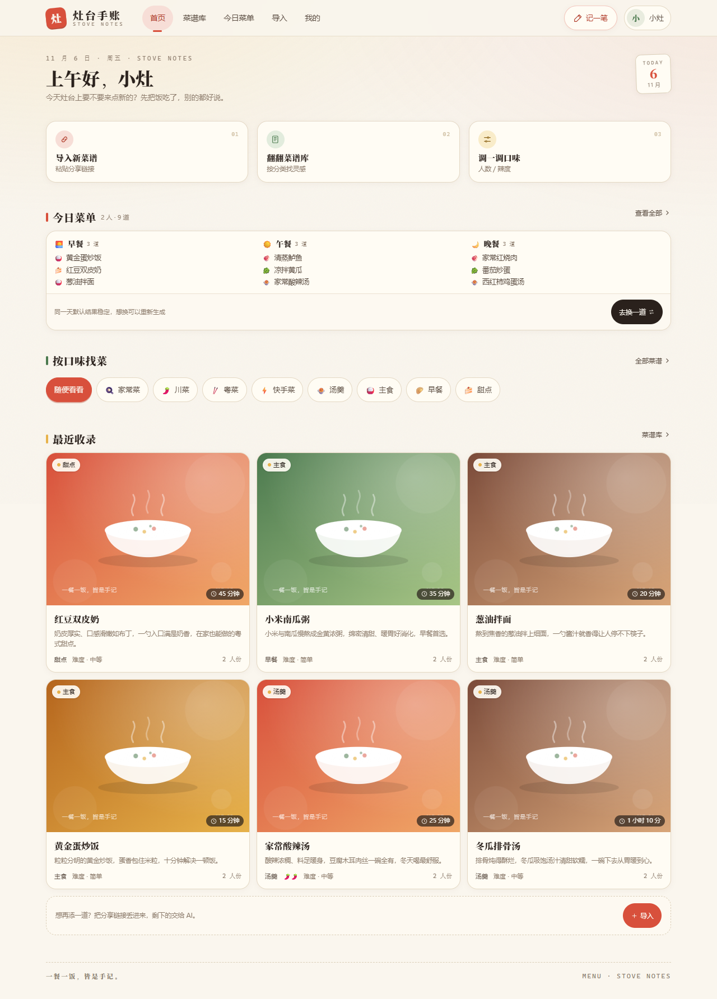
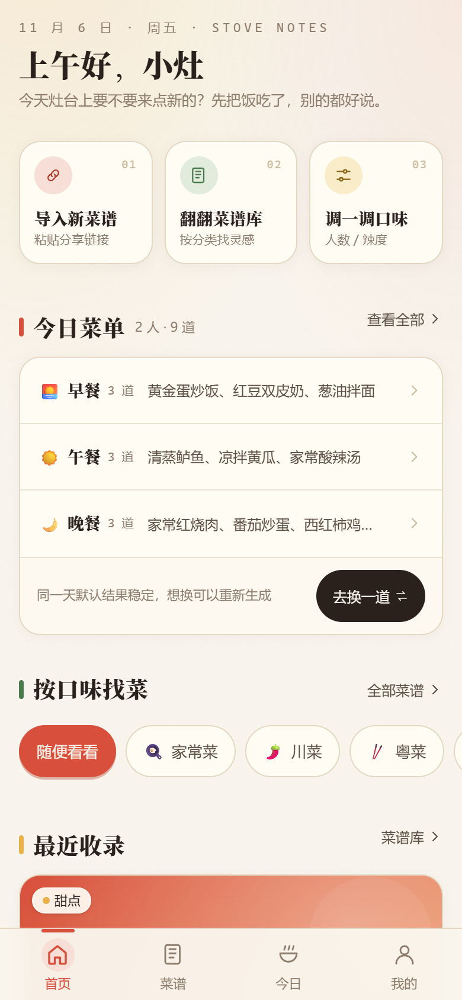
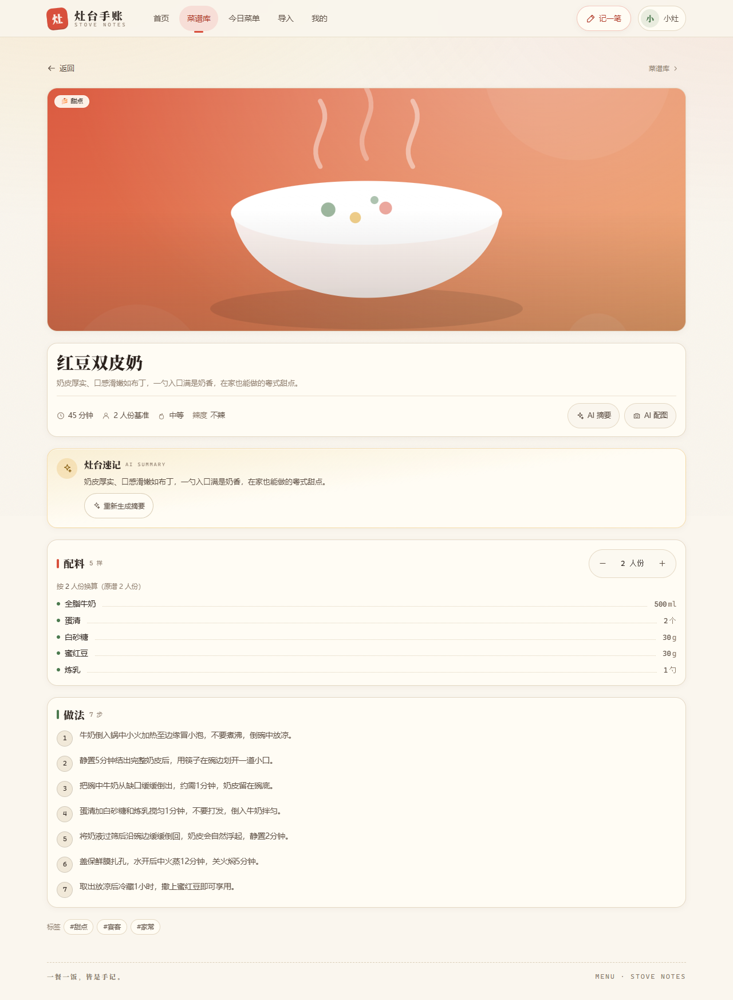
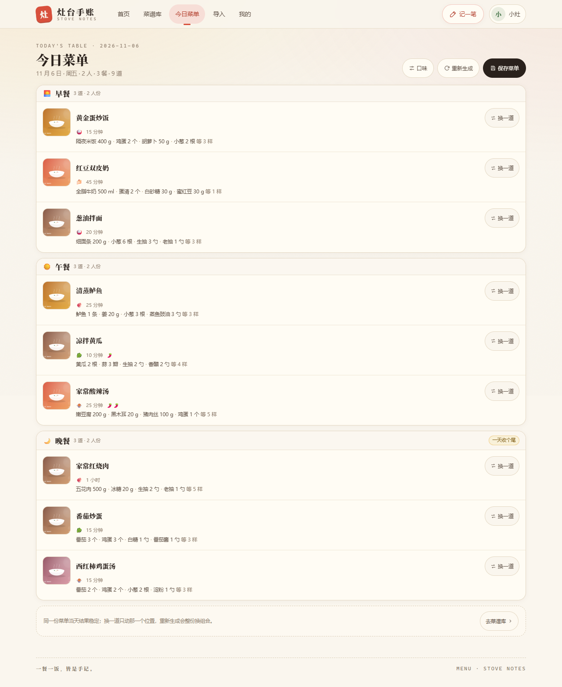
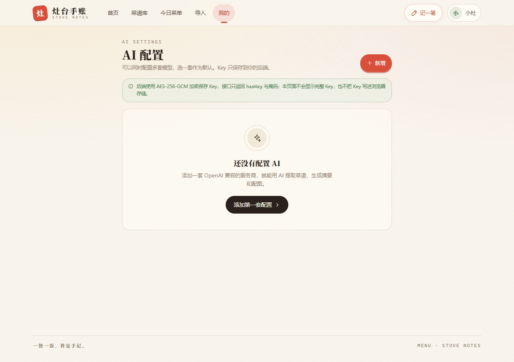
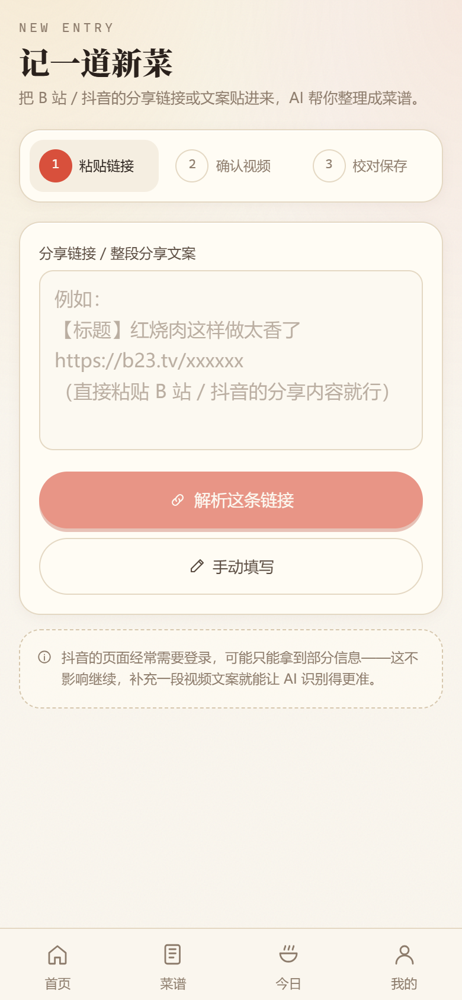
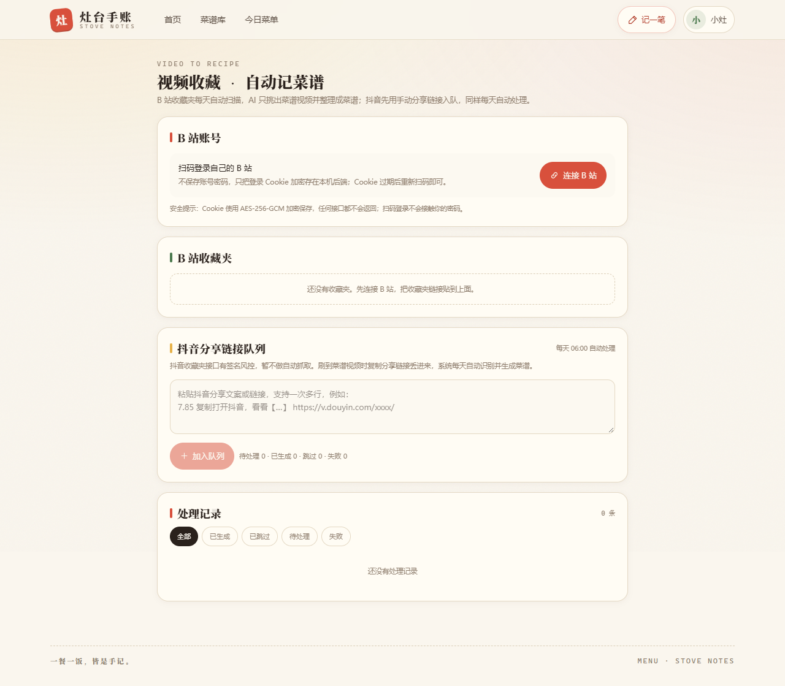
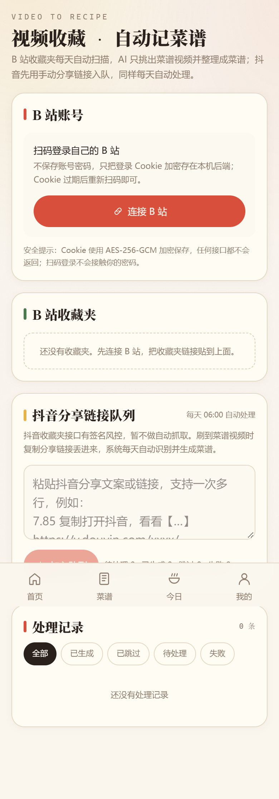

# Menu · 灶台手账

一个自用的家庭菜谱网站：从 B 站 / 抖音分享链接快速录入菜谱，支持登录、分类、用餐偏好、
多家 AI 大模型配置、AI 摘要与配图，以及**按偏好随机生成今日菜单**。桌面与手机端均已适配。

> 技术基座来自你自己的两个模板：`Vue3NewTemplate`（Vue 3 + Vite + Tailwind）与
> `SpringBootTemplate`（Spring Boot 4 + MyBatis-Plus + MySQL + Redis）。

   

## 功能

- **账号**：注册 / 登录 / JWT 鉴权，演示账号一键体验
- **菜谱库**：搜索、分类、荤素筛选、分页；内置 20 道示例菜谱 + 8 个系统分类；自己的菜谱支持编辑/删除
- **视频导入**：粘贴 B 站 / 抖音链接或整段分享文案 → 解析标题/封面/简介 → AI 结构化 → 可编辑预览 → 保存
- **AI 配置**：前端可添加多套 OpenAI 兼容配置（OpenAI / DeepSeek / 通义千问 / Kimi / 硅基流动 / OpenCode Zen / Ollama / 自定义），
  支持测试连接、设为默认；**API Key 仅在后端本地加密保存**
- **AI 能力**：菜谱摘要（卖点 + 配菜 + 搭配建议）、AI 生成菜品配图（未配置图像模型时用本地风格化封面兜底）
- **视频收藏自动生成**：B 站扫码登录后每日自动扫描指定收藏夹，AI 识别菜谱视频并生成菜谱；
  抖音因收藏夹接口风控，先提供「分享链接队列」每天自动处理
- **用餐偏好**：用餐人数、每日餐数、每餐菜品数、荤素配比、忌口食材、辣度、最长烹饪时间、偏好分类
- **今日菜单**：按偏好随机组合、同日稳定、单道换菜、重新生成、保存；配料按人数自动缩放
- **移动端**：底部 Tab、底部弹层筛选、吸底操作、安全区适配、375px 无横向滚动

## 界面预览

| 桌面端 | 移动端 |
| --- | --- |
|  |  |
|  |  |
|  |  |
|  |  |
|  |  |

全部 28 张验收截图（1280×900 桌面 / 390×844 移动）见 `docs/screenshots/`，
`report.json` 记录了每个页面的横向溢出与控制台错误检查结果（均为 0）。

## 目录结构

```
Menu/
├─ backend/                 # Spring Boot 4 + MyBatis-Plus + MySQL
│  ├─ src/main/java/com/fengxue/menu/
│  │  ├─ auth/              # 注册、登录、JWT
│  │  ├─ recipe/            # 菜谱 CRUD、封面生成
│  │  ├─ importer/          # B站/抖音解析 + SSRF 防护
│  │  ├─ ai/                # 多厂商配置、Key 加密、提取/摘要/配图
│  │  ├─ menu/              # 随机今日菜单、份量缩放
│  │  └─ seed/              # 分类 / 演示账号 / 示例菜谱
│  └─ src/main/resources/
│     ├─ db/migration/V1__init.sql
│     └─ seed/recipes.json
├─ frontend/                # Vue 3 + Vite + Pinia + Tailwind v4
├─ docs/                    # 设计规格、实施计划、API 契约
└─ README.md
```

## 本地启动

### 0. 环境要求

| 依赖 | 版本 | 说明 |
| --- | --- | --- |
| JDK | **21** | Spring Boot 4 需要；本机为 `D:\jdk-21.0.12.1` |
| Maven | 3.9+ | |
| Node.js | ^22.18.0 | 前端 Vite 8 |
| MySQL | 8.x | 本机默认 `localhost:3306` |
| Redis | 7.x（可选） | 不可用时自动降级，仅健康检查显示 DOWN |

### 1. 准备数据库

```bash
mysql -uroot -p -e "CREATE DATABASE IF NOT EXISTS recipe_menu DEFAULT CHARACTER SET utf8mb4 COLLATE utf8mb4_general_ci;"
```

默认连接：`root / FengXue@`（本机现有配置）。可通过环境变量覆盖：

```bash
DB_HOST=localhost DB_PORT=3306 DB_NAME=recipe_menu DB_USERNAME=root DB_PASSWORD=你的密码 mvn spring-boot:run
```

表结构由 **Flyway** 自动创建（`spring.flyway.enabled=true`）；首次启动还会自动播种 8 个分类、
20 道示例菜谱和演示账号。

### 2. 启动后端（8080）

```bash
cd backend
# Windows PowerShell 示例
$env:JAVA_HOME='D:\jdk-21.0.12.1'
mvn spring-boot:run
```

或打包运行：

```bash
mvn -DskipTests package
java -jar target/menu-backend.jar
```

- Swagger UI：<http://localhost:8080/swagger-ui.html>
- 健康检查：<http://localhost:8080/api/health>

### 3. 启动前端（5173）

```bash
cd frontend
npm install
npm run dev
```

打开 <http://localhost:5173>。Vite 已配置 `/api` 代理到 `http://localhost:8080`。

**手机/局域网访问**：Vite 已开启 `host: true`，手机与电脑在同一局域网时打开
`http://<电脑局域网IP>:5173` 即可（例如 `http://10.8.131.19:5173`）。
Vite 代理会统一改写 `Origin`，后端 CORS 默认也放行 `localhost` 与
`192.168.*` / `10.*` / `172.*` 私有网段；如需收紧或追加来源，通过 `CORS_ORIGINS` 显式配置。

### 4. 演示账号

```
用户名：demo
密码：123456
```

## 视频收藏 → 自动生成菜谱

入口：**我的 → 视频收藏**。

### B 站（全自动）

1. 点「连接 B 站」，用 B 站手机 App 扫码并确认；
   - 后端通过官方 Web 二维码登录获取 Cookie，使用 **AES-256-GCM 加密**保存；
   - 不保存账号密码，接口不返回 Cookie，过期后重新扫码。
2. 把收藏夹链接（形如 `https://space.bilibili.com/xxx/favlist?fid=123456`）粘贴进来；
3. 每天 **06:00** 自动扫描（可用 `INTEGRATION_SCAN_CRON` 修改），也可以在页面点「立即扫描」；
4. 对新增视频：标题 + 简介 → AI 判断是否菜谱 → 是则提取配料/步骤并生成菜谱；
   - 非菜谱标记「不是菜谱」，不重复调用 AI；
   - 每轮最多处理 20 条新视频，结果可在「处理记录」查看；
   - 生成的菜谱自动进入菜谱库，参与「今日菜单」随机。

> 自动生成菜谱需要当前账号先在 **AI 配置** 里配置一个可用模型；未配置时视频只会进入「待处理」队列，
> 不会自动创建菜谱。扫描只依据视频标题与简介（不下载视频、不做语音转写）；标题很模糊时 AI 可能判断不准，
> 但不会重复处理。B 站页面改版可能导致收藏夹接口变化，届时需要更新解析逻辑。

### 抖音（分享链接队列）

抖音收藏夹接口有签名风控（直接请求返回 403），暂不做自动抓取。刷到菜谱视频时把**分享链接/文案**
粘贴到「抖音分享链接队列」，系统每天 06:00 自动解析并调用 AI 生成菜谱；也可以手动触发扫描。
后续如果要做真正的抖音收藏夹自动同步，只能增加浏览器扩展/本机浏览器自动化，稳定性另评估。

### 定时与环境变量

| 变量 | 默认值 | 说明 |
| --- | --- | --- |
| `INTEGRATION_SCAN_CRON` | `0 0 6 * * *` | 每日扫描 Cron（Asia/Shanghai） |


登录后进入 **我的 → AI 配置**：

1. 选择服务商预设（自动填 Base URL 与常用模型名）；
2. 填写对话模型名与 API Key；如需 AI 配图，再填写图像模型名（如 `gpt-image-1`、
   `Kwai-Kolors/Kolors`，需服务商支持 OpenAI 兼容的 `/images/generations`）；
3. 保存后可「测试连接」，并设为默认配置。

支持任意 **OpenAI 兼容** 接口：`{baseUrl}/chat/completions`、`{baseUrl}/images/generations`。

### OpenCode Zen 特别说明

OpenCode Console 提供 OpenAI 兼容接口，已内置预设：

- Base URL：`https://opencode.ai/inference/openai/v1`
- 协议：`POST /chat/completions`
- Key：OpenCode Console 的 Personal API Key

注意区分两件事：

- Console 的 Models 页面能勾选/看到 `Free` 模型，只代表这些模型**对 OpenCode 客户端开放**；
- 官方 Inference API 文档明确说明：“Free-tier chat models are only available from within OpenCode;
  other clients receive HTTP 403, even with an API key.”
  （见 [OpenCode Inference API 文档](https://opencode.ai/v2/docs/console/api/inference/)，
  以及官方置顶 issue [#59387](https://github.com/anomalyco/opencode/issues/59387)）

可以用下面的命令验证**你的 Key**到底能不能调免费模型（不要泄露 Key）：

```bash
curl -sS -w '\nHTTP %{http_code}\n' https://opencode.ai/inference/openai/v1/chat/completions \
  -H "Authorization: Bearer $OPENCODE_API_KEY" \
  -H "Content-Type: application/json" \
  -d '{"model":"big-pickle","messages":[{"role":"user","content":"只回复 OK"}],"max_tokens":8}'
```

- 返回 `HTTP 200`：说明你的账号/Key 可以走 API，在本网站把对话模型改成 `big-pickle`
  或 `deepseek-v4.1-flash-free` 即可；
- 返回 `403` / `429 FreeUsageLimitError`：说明免费模型被限制在 OpenCode 客户端内，
  请改用付费模型 / Go 订阅，或使用下面的免费替代方案。

本网站的 OpenCode 预设默认填的是付费模型 `deepseek-v4.1-flash`，模型名可以自由修改。

### 想免费先测试 AI 功能？

1. **本地 Ollama（推荐，免费且数据不出本机）**：安装 [Ollama](https://ollama.com/) 后执行
   `ollama pull qwen2.5:7b`，在 AI 配置中选择「Ollama（本地）」，Key 留空；
2. **仓库自带 Mock AI**：不需要任何模型/额度，验证导入 → AI 提取 → 摘要 → 配图全链路；
3. 硅基流动等提供免费额度的 OpenAI 兼容服务，选择「自定义」填对应 Base URL 与模型。

### 没有真实 Key 时本地自测

仓库自带一个 Mock AI 服务，可在不消耗真实额度的情况下验证「AI 提取 → 摘要 → 配图」全链路：

```bash
python scripts/mock-ai-server.py     # http://127.0.0.1:9999/v1
```

在网页「AI 配置」中新增：Base URL `http://127.0.0.1:9999/v1`、对话模型 `mock-chat`、
图像模型 `mock-image`、Key 任意填写即可。

### Key 安全设计

- API Key 使用 **AES-256-GCM** 加密后存入 MySQL；主密钥在首次启动时生成到 `backend/data/secret.key`
  （32 字节随机，已加入 `.gitignore`，也可用环境变量 `AI_KEY_MASTER`（Base64）覆盖）。
- 前端/接口只返回 `hasKey` 与掩码（如 `sk-****abcd`），**永远不会回传明文**。
- 所有 AI 请求由后端代理，Key 不进入浏览器，不受厂商 CORS 限制。
- 日志只记录服务商与模型名，不记录 Key；服务端不打印请求体。
- 修改配置时留空 Key 表示保留原 Key。

## 视频导入说明

- **B 站**：通过公开接口获取标题、简介、封面、时长，并尝试抓取字幕（部分视频需要登录，失败会提示）。
  `b23.tv` 短链会自动跟随跳转；详情页可嵌入官方播放器。
- **抖音**：页面有反爬限制，解析失败时仍会从分享文案中提取标题/作者，返回 `warnings`；
  此时可把视频文案/字幕粘贴到「补充文案」中，再让 AI 提取。**不下载视频、不做语音转写。**
- 安全：仅允许 B 站/抖音域名；每次重定向都校验；禁止内网/回环地址；限制超时与响应大小（防 SSRF）。

## 测试与构建

```bash
# 后端
cd backend && mvn test          # 38 个单元测试（JWT / Key 加解密 / SSRF / 菜单算法 / 收藏夹解析）
mvn -DskipTests package

# 前端
cd frontend && npm run test     # 37 个用例（scale / platform / RecipeCard）
npm run build                   # vue-tsc + vite build
npm run lint                    # ESLint 0 error 0 warning
```

视觉与移动端验收（需后端 + `npm run dev` 已启动）：

```bash
cd tools/e2e && npm install && node screenshots.cjs
# 输出 docs/screenshots/desktop、mobile 与 report.json；横向溢出/控制台错误会打印并给出非零退出码
```

## 环境变量

| 变量 | 默认值 | 说明 |
| --- | --- | --- |
| `SERVER_PORT` | 8080 | 后端端口 |
| `DB_HOST` / `DB_PORT` / `DB_NAME` | localhost / 3306 / recipe_menu | MySQL |
| `DB_USERNAME` / `DB_PASSWORD` | root / FengXue@ | MySQL 账号 |
| `REDIS_HOST` / `REDIS_PORT` | localhost / 6379 | 可选 |
| `FLYWAY_ENABLED` | true | 自动建表 |
| `JWT_SECRET_FILE` | data/jwt.secret | JWT 密钥文件 |
| `AI_KEY_MASTER_FILE` | data/secret.key | AI 主密钥文件 |
| `AI_KEY_MASTER` | 空 | Base64 32 字节，优先于文件 |
| `UPLOAD_DIR` | data/uploads | AI 配图存储目录 |
| `INTEGRATION_SCAN_CRON` | `0 0 6 * * *` | 每日视频收藏扫描时间（Asia/Shanghai） |
| `CORS_ORIGINS` | localhost / 私有网段 | 允许的前端来源模式，逗号分隔 |

## 常见问题

1. **抖音解析不到详情？** 平台风控导致，属预期行为。复制完整分享文案或粘贴视频文案即可继续。
2. **AI 配图失败？** 当前配置没有图像模型或服务商不支持 `/images/generations`；会自动用本地风格化
   SVG 封面兜底，不影响菜谱保存。
3. **Redis 没启动？** 不影响主要功能；`/api/health` 中 `redis=DOWN`，应用仍为 `UP`。
4. **端口被占用？** 通过 `SERVER_PORT` 修改后端端口，同时修改 `frontend/vite.config.ts` 的代理目标。
5. **忘记数据库密码？** 通过 `DB_PASSWORD` 环境变量传入，或修改 `application-dev.yml`。
6. **手机/局域网打开后登录提示「没有权限执行该操作」或接口 403？**
   这是旧版后端的 CORS 白名单只允许 `localhost` 导致的（Spring 返回 `403 Invalid CORS request`）。
   当前版本已修复：Vite 代理会改写 `Origin`，后端默认放行 `192.168.*` / `10.*` / `172.*` 私有网段。
   **升级后必须重启后端**（IDEA 里也要重新 Run，旧进程不会热加载配置）；如仍失败，
   用 `CORS_ORIGINS=http://你的IP:5173` 启动后端，并确认手机与电脑同一局域网。
7. **同一浏览器切换账号？** JWT 存在当前浏览器的 localStorage，不同浏览器/设备互不影响；
   换账号请先在「我的 → 退出登录」，或换一个浏览器/无痕窗口。

## 设计与接口文档

- 设计规格：`docs/superpowers/specs/2026-11-06-recipe-menu-app-design.md`
- 实施计划：`docs/superpowers/plans/2026-11-06-recipe-menu-app.md`
- API 契约：`docs/api-contract.md`
